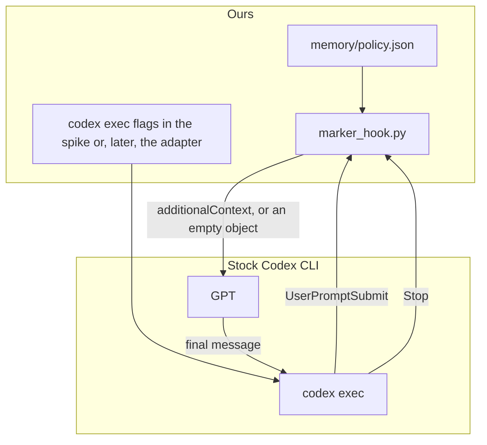
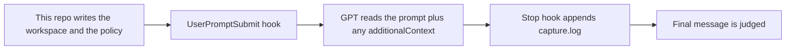
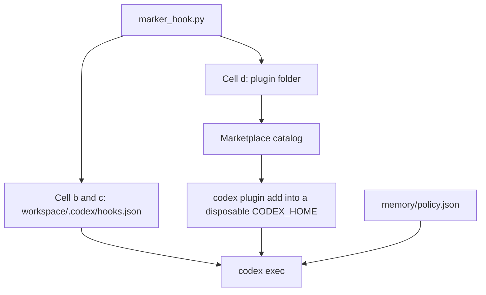
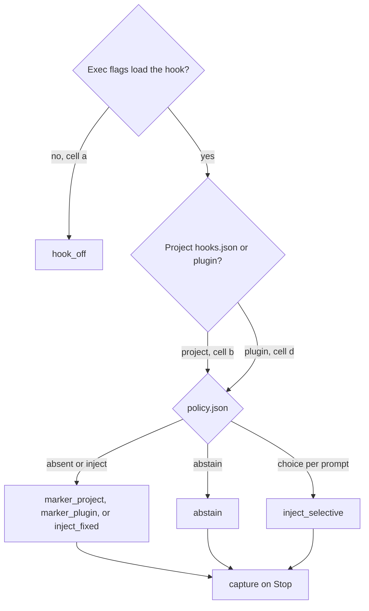

# Harness

Third-party agent integrations live here. The LoCoMo eval library stays in
`src/locomo_eval/`. A later `model/` directory would sit next to this one,
beside `prompts/`, `scripts/`, and `infra/`.

This slice is a hello world for Codex. It checks whether a stock CLI can
add a string to the model context, add nothing, and leave a log. It does
not extract personalization patterns. Terms:
[GLOSSARY.md](GLOSSARY.md). Recorded outcomes:
[codex/spikes/RESULTS.md](codex/spikes/RESULTS.md).

## Version and claim labels

Recorded on `codex-cli 0.155.1` (`harness/codex/VERSION`). Behavior on a
newer CLI is not guaranteed. Re-run spike 0 before trusting a different
build.

Three kinds of statement appear below:

| Label | Meaning |
| --- | --- |
| Observed | What the 0.155.1 hello-world run did. Source: `RESULTS.md` and the gitignored JSONL under `harness/codex/spikes/runs/`. |
| Documented | What OpenAI's hook and plugin docs, or this CLI's `--help`, say. |
| Assumption | A design choice or a later experiment. Not a result. |

A smoke pass is two observed facts together: the hook log contains the
expected action, and the model's final message echoes a token. That is
not three separate claims. Those claims stay apart:

| Assertion | What would show it | Status |
| --- | --- | --- |
| Hook invoked | `hook_log.jsonl` has a row. | Observed for cells b, c, and d. Absent for cell a. |
| Context delivered | The model echoes a token that was only in `additionalContext`. | Observed as a smoke echo on the one-line prompt. The provider request body was not captured. |
| Context used correctly | A realistic answer follows the injected material, and withholds it when it does not apply. | Not run. |

`--dangerously-bypass-hook-trust` is only for these disposable homes and
for `marker_hook.py`, which this repo wrote. It is not for an unreviewed
third-party hook. A hook is a separate process. It can write files even
when the model's shell sandbox is `read-only`.

## What we change

The installed Codex CLI stays as it is. We do not patch its source. We add
a hook, and we start `codex exec` with flags that let Codex load that hook.

A hook is the program Codex runs at a moment in the turn. A plugin is the
installable folder that carries that hook (name, version, `hooks.json`).
The policy is a separate file in the workspace, `memory/policy.json`. The
hook reads it and decides what to inject. A marketplace is the catalog
that points `codex plugin add` at the plugin folder.

```text
marketplace catalog  ->  plugin package  ->  hook program  ->  reads policy.json
```

Cell b does the same job without a plugin: it writes `.codex/hooks.json`
straight into the workspace. Cell d uses the catalog and the package.
In the 0.155.1 record, both paths echoed the marker on the smoke prompt.

The LoCoMo adapter still launches Codex with `--ignore-user-config`.
On this CLI that flag skips the project hook layer, which is why cell a
left the hook unstarted. Changing those launch flags is our change too.
It is a change to our command line, not to the Codex binary.



One exec, in order:



Two ways to attach the same hook:



What the design can vary, and what it leaves alone:

| Layer | Who owns it | What a later experiment changes |
| --- | --- | --- |
| Policy file | Us | The text injected, or abstain. This is the H2 switch. |
| Hook program | Us | How a policy becomes `additionalContext` and a log line. |
| Project `hooks.json` | Us | Direct attach, no install step. Cells b and c. |
| Plugin package | Us | The same hook, installed by id. Cell d. |
| Marketplace | Us | The catalog entry for that package. |
| Exec flags | Us | Trust, hook-trust bypass, and whether user config is loaded. |
| Codex CLI | Installed binary | Left on the pinned version in `harness/codex/VERSION`. |
| Codex memories | Codex feature | Left unused. Docs say `--ephemeral` skips session rollouts. This repo has not measured that pipeline. The hook still ran with `--ephemeral` in the 0.155.1 record. |
| Model | `--model` | Which GPT writes the reply. The hello world uses `gpt-4o-mini`. |

## Components

```text
marketplace     catalog. Cell d only. Points at the plugin folder.
plugin          installable package. Manifest is root plugin.json. Hooks are hooks/hooks.json.
hooks.json      which script runs at which event. Project file, or inside the plugin.
hook            marker_hook.py. Reads the policy. Writes additionalContext or {}.
policy          memory/policy.json in the workspace. The experimental switch.
exec flags      whether Codex loads the hook at all. Cell a skips that load.
Codex CLI       stock binary. Unchanged.
GPT             writes the final message.
```

The chain for a plugin run is `marketplace -> plugin -> hook -> policy`.
A project-hook run skips the first two and points `hooks.json` at the same script.

## Simple conditions

Each condition is one exec. The Codex binary stays pinned. The hook script
stays `marker_hook.py`. Conditions differ by launch flags, by project file
versus plugin, and by `memory/policy.json`.

| Condition | Attach | Policy | What it is | 0.155.1 record |
| --- | --- | --- | --- | --- |
| `hook_off` | Cell a flags. Hook file may sit on disk. | Unused | Launcher control. | Hook log empty. Model said `MISSING`. |
| `marker_project` | Cell b. `workspace/.codex/hooks.json`. | Absent, so the hook injects `HARNESS_MARKER_ALPHA`. | Smoke: invoke plus echo. | Log `inject`. Model said `SEEN`. |
| `marker_plugin` | Cell d. Marketplace, then `harness-marker@harness-spikes`. | Same injection. | Smoke: plugin path echoes the same token. | Log `inject`. Model said `SEEN`. |
| `abstain` | Cell b in the record. Cell d is the same hook. | `{"action": "abstain"}` | Smoke: hook ran, stdout `{}`, token absent. | Log `abstain`. Model said `MISSING`. |
| `inject_fixed` | Cell b or d. | `{"action": "inject", "text": "..."}` | Unfiltered arm: one block on every prompt. | Smoke echo of `HARNESS_MARKER_BETA` on cell b. A realistic memory block is not run. |
| `inject_selective` | Cell b or d. | A per-prompt relevance decision, then inject or abstain. | Application arm. | Not run. Accepting both actions in the hook is not this policy. |
| `capture` | `Stop` on a loaded hook. | Whatever the prompt used. | Side log that the exec ended. | One `captured` line on each smoke exec that loaded the hook. Exactly-once across multi-step execs is not run. |

`inject_fixed` and `inject_selective` need no Codex patch. They need a
policy file and a launch of cell b or cell d. `inject_selective` also
needs a relevance rule and counts of wrong injections and wrong
abstentions. `hook_off` is the launcher LoCoMo runs use today. Cell a and
cell b differ by several flags, so that pair is not a single-flag test.



## What a hook is

Codex can start a program at named points in a turn. The program reads one
JSON object on stdin and writes a JSON object on stdout. For
`UserPromptSubmit`, `hookSpecificOutput.additionalContext` is extra
developer context for that turn. An empty object `{}` adds nothing.
`decision: "block"` on `Stop` does not cancel the turn. It asks Codex to
continue. The capture hook returns `{}` so the turn ends.

The script is `harness/codex/plugin/hooks/marker_hook.py`. With no
`memory/policy.json` it injects `HARNESS_MARKER_ALPHA`. With a policy file:

| `memory/policy.json` | Stdout | Meaning |
| --- | --- | --- |
| absent | `additionalContext` = the marker | Spike 1 smoke. The log shows the process ran. An echo is the delivery check on this prompt. |
| `{"action": "abstain"}` | `{}` | The policy withheld context. |
| `{"action": "inject", "text": "HARNESS_MARKER_BETA"}` | `additionalContext` = that text | The policy chose the text. |

`Stop` appends one line to `memory/capture.log`.

## What the flags mean

These are `codex exec` flags. Cell definitions are
`configs/agents/hooks/hello_world.yaml`.

| Flag | What Codex does with it |
| --- | --- |
| `--ignore-user-config` | Do not load `$CODEX_HOME/config.toml`. Auth still uses `CODEX_HOME`. The help text does not mention project `.codex/`. Cell a keeps this flag because the LoCoMo adapter always passes it. |
| `--ignore-rules` | Do not load execpolicy `.rules` files. Every cell keeps this so a local rule cannot block the run. |
| `--ephemeral` | Documented: do not persist the session rollout. Cells a, b, and d pass it. Cell c does not. In the 0.155.1 record the hook still ran with the flag on. This repo has not measured Codex's own memories pipeline. |
| `--dangerously-bypass-hook-trust` | Run hooks without the interactive trust prompt. Used here so `codex exec` can start our script. It does not discover a hook the process never loaded. Disposable home and this repo's script only. |
| `--enable hooks` | Turn on the hooks feature for this invocation. On the pinned CLI, `hooks` is already stable and on. `plugin_hooks` is removed, so the spike does not enable that name. |
| `-c projects.'<dir>'.trust_level="trusted"` | Trust the workspace so its `.codex/hooks.json` can load. On Windows the key is the resolved path, lowercased, with backslashes, inside a TOML literal string. The same table is written into the disposable `CODEX_HOME/config.toml`. |

Codex treats the git root as the project. A `.codex/` folder inside this repository is the repo's project layer, not the spike workspace. Live workspaces are created under the system temp directory so the hook file and the trust key refer to the same directory.

Cell a is the current adapter. In the 0.155.1 record, cells b and c echoed
the marker and cell a did not. Those cells also differ in trust and hook
bypass, so the record does not isolate `--ignore-user-config` alone.

## Plugin versus project hook

Cells a–c write `.codex/hooks.json` into the workspace. Cell d does not.
It installs `harness/codex/plugin` through `codex plugin marketplace add`
and `codex plugin add harness-marker@harness-spikes` into a disposable
`CODEX_HOME`. The committed `hooks.json` shows the `${PLUGIN_ROOT}` form.
The committed plugin manifest is the root file
`harness/codex/plugin/plugin.json`. It sets
`extensions.com.openai.hooks` to `./hooks/hooks.json`. This experiment
does not use a `.codex-plugin/plugin.json` overlay. The spike stages a
copy whose command is an absolute Python path, so a miss in that run
means the plugin was not loaded, not that `python` was absent from `PATH`.

Every exec gets its own `CODEX_HOME`. The user's `~/.codex/config.toml` is
not copied. An API key is used when `CODEX_API_KEY` or `OPENAI_API_KEY` is
set. Otherwise only `auth.json` is copied.

## Run

```bash
python harness/codex/spikes/run_codex_hello_world.py --spike 0
python harness/codex/spikes/run_codex_hello_world.py --spike all
python harness/codex/spikes/run_codex_hello_world.py --spike 1 --cell b_project_hooks
```

Spike 0 writes `harness/codex/VERSION`. Spikes 1–3 call the model named in
the YAML (`gpt-4o-mini` unless `--model` is set). Logs land in
`harness/codex/spikes/runs/` and are gitignored.

A smoke pass is a hook log plus the echoed token. A log without the token
means the hook ran in that exec and the echo failed. The token without a
log is contamination. Neither outcome shows that a realistic task used
the injected text.

In the 0.155.1 record, cells b, c, and d smoke-passed. Cell a left an
empty hook log. The pinned note is `harness/codex/spikes/RESULTS.md`.

## Plus decisions through Codex

The personalization package writes `memory/policy.json`. This hook
delivers that file. Fact-recall launches keep `project_hooks` off, so
they still use cell a. A personalization call sets `project_hooks` and
uses the cell-b flags.

Offline checks do not need a model:

```bash
python -m pytest tests/test_codex.py tests/test_personalization_poc.py tests/test_personalization_e2e.py -q
python -m src.locomo_eval.interaction_patterns.offline_decision_pack
python -m src.locomo_eval.interaction_patterns.labeled_plus_run --dry-run
```

The Plus file is gitignored. Fetch it, then build the label starter.
Draft labels live in `src/locomo_eval/interaction_patterns/plus_draft_labels.py`. Saved
sheets and exec logs stay gitignored.

```bash
python -m src.data.locomo_plus --fetch --path data/raw/locomo_plus.json
python -m src.locomo_eval.interaction_patterns.plus_starter_and_overlap
python -m src.locomo_eval.interaction_patterns.labeled_plus_run
python harness/codex/spikes/run_plus_codex_smoke.py
```

`e2e` calls gpt-4o-mini and writes `experiments/personalization-e2e`.
The Codex smoke reads that pack. Pass `--pack` for a different one.
Both directories are gitignored. A smoke pass is hook delivery.
It is not a reply score.
